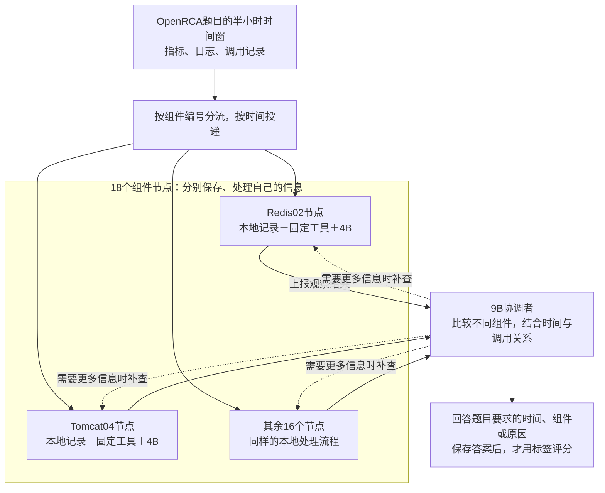

# EdgeRCA：用小模型智能体集群做根因分析

更新：2026-10-20。最新一轮144524已完成Bank全部136题评分；下文采用本次核对结果，并区分两种时间容差。

## 1. 核心思想：每个小模型管一处，协调者把信息连起来

OpenRCA提供系统运行时的指标、日志和调用记录，要求找出故障的时间、组件或原因。困难在于数据量大、线索分散：一个小模型难以一次看清全部信息，提前压成固定摘要又可能漏掉关键变化。

**我们的办法是建立小模型智能体集群：多个4B节点分别处理自己组件的数据，9B协调者综合各节点的信息，缺什么就向对应节点补查。**每个节点都处理本地的指标、日志和调用，不按“时间专家、原因专家、组件专家”分工。

**这里的“集群”体现为独立的数据范围、节点任务和往返通信。**18个节点可以复用同一个4B模型，但各自保存本地记录；9B负责跨节点比较。目标是部署到不同边缘设备，当前先在服务器上顺序模拟，尚未实现18台设备同时在线运行。

## 2. 现在怎样跑一道题

1. **分数据。**Bank按原始记录的组件编号建立18个节点。组件可以是缓存、数据库或应用实例，不等于18台真实机器；业务数据另行保存。
2. **回放并整理。**每10秒投递一批原始记录，全部保存。程序检测变化、计算数值和时间，整理指标、日志与调用观测。
3. **节点理解并上报。**4B读取程序提供的材料，按模板解释现象、选择上报内容。数值和记录编号由程序提供，模型不用写代码计算。
4. **协调者比较并补查。**9B读取节点摘要、最多14个候选组件的观测索引，以及本轮选入的观测正文，结合业务变化和调用关系比较。候选索引提示“哪些组件有哪些材料”，不代表这些组件都发生故障。目录已改为单页节点索引；需要细节时，9B提出要求，程序查询对应节点，4B整理回复后再交给9B。

当前批量实验是**先回放完半小时，再集中分析**，还不是每10秒调用18个模型。当前也没有加入PPO、经验库或60%/40%的训练划分，先验证这个集群能否完成诊断。

## 3. 用一道真实题理解9B的工作

以下是最新144524中的Bank第2题：2021年3月4日18:00—18:30，哪个组件因什么原因发生故障？本题只评价组件和原因。

| 环节 | 实际发生了什么 |
|---|---|
| 4B首轮 | Redis02内存占比进入展示材料，4B展开并选择上报；统计中包含范围11%～98%、中位数23% |
| 9B输入 | 已读到Redis02内存98%、18:10极值时刻及前后对照 |
| 9B比较与补查 | 考虑了Redis02内存占用高，也提出Tomcat03、Tomcat04内存溢出的猜测，并要求节点补查 |
| 最终判断 | 仍选择“Tomcat03／JVM堆内存溢出”，答错；标准答案为“Redis02／内存占用高” |

**这道题的关键变化已经送到4B和9B，最终仍然答错。**9B把GC日志和长调用组合成了内存溢出判断，但这些现象本身不足以证明内存溢出。需要分别检查“材料是否送到”和“模型是否正确理解”，不能把所有错误都归因于材料遗漏。

## 4. 已有实验结果

目前只验证Bank。两轮均完成136题评分；完全正确要求答对该题所问的全部字段，“至少一项正确”包含完全正确。不是每道题都同时考时间、组件和原因。

| 实验 | 时间容差 | 完全正确 | 至少一项正确 |
|---|---|---:|---:|
| 上一轮143858 | ±5分钟，本轮运行设置 | 13.97%（19/136） | 37.50%（51/136） |
| **最新144524** | **±5分钟，本轮运行设置** | **16.18%（22/136）** | **39.71%（54/136）** |
| 上一轮143858，同一批答案重评 | ±1分钟，官方设置 | 9.56%（13/136） | 28.68%（39/136） |
| **最新144524，同一批答案重评** | **±1分钟，官方设置** | **11.76%（16/136）** | **31.62%（43/136）** |

±1分钟结果是对已保存答案重新评分，没有重新调用模型。两种时间容差只影响要求回答时间的题。

本轮完全正确比上一轮多3题，**有小幅变化，但没有大幅改善**。需要同时看到：

- 136题评分齐全，但有5题最终回答未通过校验，按0分计入；主要是输出时间与引用证据不对应。
- ±5分钟下，18道双故障题完全正确为 **0.00%（0/18）**，上一轮为5.56%（1/18）。
- 最新136题使用同一源码快照，上一轮逐题快照不完全一致；不能把差值当作某一项改动的严格消融收益。

自动诊断报表的失败归因还需纠正：其中“95题组件候选未找到”包含49道没有组件标签的题，不能据此认定95题都卡在候选阶段。这里不沿用该统计来判断主要失败原因。以上属于开发过程中的批量验证，尚不是独立留出的最终评估。

## 5. 当前进展与主要问题

**本轮已启用：**优先展示重要变化、保留4B上报或不确定的观测、增加组件候选表、用单页节点索引替代25页事实目录。

**有代码但本轮未启用：**4B“含义、能回答什么、不能确认什么、下一步查什么”四栏详细回复，以及正式Top-3候选输出。上表不能当作这两项功能的效果。

仍需解决四点：

1. **材料是否看全。**首轮仍最多展示12项，优先规则不保证关键观测全部入选；待查也没有保证稍后自动展开。
2. **节点是否答清。**旧填写过于简略；工具只给统计时，不能充分回答完整曲线、高值次数和持续情况。
3. **中央是否判断正确。**相关现象可能被误当根因；需要更好地比较支持、反证和未查清的问题。
4. **输出与统计是否可靠。**最终时间引用校验仍会失败；诊断统计应按题目实际要求的字段分别计算。

结果核对：[本次核对说明](../outputs/bank_review_144524_20261020/核对结果.md)、[含两种容差的逐题数据](../outputs/bank_review_144524_20261020/summary.json)、[最新原始评分](../outputs/bank_accuracy_144524/summary.json)。最新案例见[144524第2题](../outputs/bank_case_144524_1/evaluation/result.json)；更多历史流程见[详细报告](EdgeRCA_项目说明与汇报.md)。
